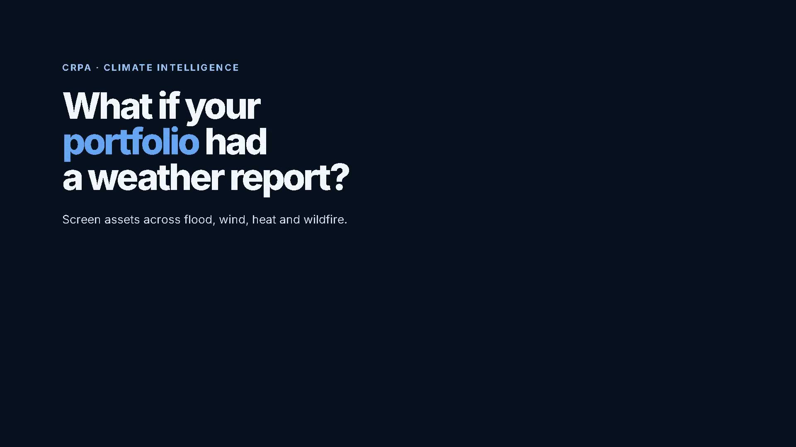
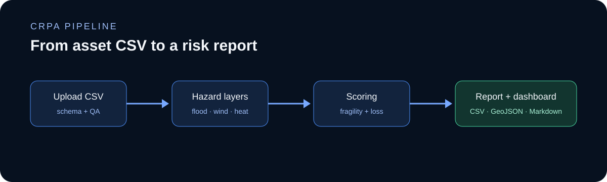

# Climate Risk Portfolio Assessor

Climate Risk Portfolio Assessor (CRPA) reads an asset CSV and produces multi-hazard screening scores, scenario loss estimates, a Streamlit dashboard, and a Markdown report. It runs locally and is distributed under a proprietary commercial license.

When no live layers or API keys are available, CRPA uses synthetic demo values. Each result records its source and confidence so demo values remain separate from values backed by a real dataset.

## Product preview





The short product preview is also available as [`brag.mp4`](../brag-output-2026-10-07-120000/brag.mp4) in the development workspace.

## Start the app

On Linux or macOS:

```bash
./run.sh setup
./run.sh dashboard   # http://localhost:8502
./run.sh api         # http://localhost:8000/docs
```

On Windows:

```powershell
python -m venv .venv
.venv\Scripts\pip install -r requirements-dev.txt
.venv\Scripts\streamlit run app\dashboard.py
```

The `run.bat` file starts the API and dashboard together. To run the command-line workflow:

```bash
./run.sh cli data/templates/portfolio_upload_template.csv --scenario ssp585 --no-llm
```

## Input CSV

The required columns are:

```text
asset_id,name,lat,lon,state,asset_class,replacement_value
```

Supported asset classes include office, industrial, retail, residential, hospital, data_center, infrastructure, hotel, and other. Values such as `50000000`, `$50,000,000`, `50M`, and `2.5k` are accepted. The default limit is 500 assets and can be changed with `CRPA_MAX_ASSETS`.

Optional columns (see `data/templates/portfolio_enhanced_template.csv`) may be left blank; a blank cell means "not supplied". Optional money columns accept the same formats as `replacement_value`. Negative values, impossible years and non-finite coordinates are rejected row by row.

CRPA checks the schema, coordinates, duplicate IDs, duplicate assets, null-island coordinates, state and coordinate mismatches, and coordinate precision. Invalid rows are dropped and described in the QA report.

Supported coverage is the United States and Pakistan (the `state` column and coordinate bounds are validated against those). The `data/templates/europe_*.csv` files are not accepted by the current release and are kept only as drafts for a future Europe connector.

## How a run works

1. `src/ingestion.py` validates the input and performs spatial checks.
2. `src/hazards.py` reads local rasters, cached or free APIs, and then synthetic fallbacks. Each result carries a source label.
3. `src/fragility.py` applies the current HAZUS-inspired screening curves. It keeps hazard, vulnerability, risk score, severity, data status and source quality in separate columns and calculates a scenario loss.
4. `src/reporting.py` calls the configured OpenAI-compatible LLM when available. If the call fails, CRPA writes a deterministic report instead.

Results are written below `outputs/<run-id>/`, including asset scores, GeoJSON, an optional GeoPackage, a portfolio summary, QA details, and the report.

## Reading the results

Every asset gets a rating for each of six hazards. Colour identifies the hazard and never carries severity; severity is always written as a word and shown as a four-step bar meter.

| Hazard | Code | Colour | Basis of the rating |
| --- | --- | --- | --- |
| Flood | FLD | blue | hazard x vulnerability x consequence |
| Fire | FIR | red | hazard x vulnerability x consequence |
| Extreme heat | HET | orange | hazard x vulnerability x consequence |
| Wind | WND | slate | hazard x vulnerability x consequence |
| Landslide | LSL | purple | hazard index only (no damage function), needs a local raster |
| Drought (dry spell) | DRT | yellow | hazard index only (no damage function), needs the Open-Meteo API |

Severity is Low (score under 25), Medium (25 to 49), High (50 to 74) or Critical (75 and above). These are screening thresholds, not validated limits. Each rating also has a data status: assessed (real data), illustrative (synthetic input; the result shows the method only) or not assessed (no data). A hazard that is not assessed is shown as "No data" and is never counted as low risk. A Low rating is shown as verified (green) only when every modelled hazard has real data of at least medium source quality.

The Hazard Risk tab has a legend, hazard and severity filters, a portfolio comparison chart, an asset-by-hazard matrix and an inspector with the contributing factors, the scenario and the recommended actions for each hazard. The Map tab colours markers by hazard and sizes them by severity.

The risk-score range shown for each asset comes from a plus or minus 15 percent change in hazard intensity. It shows how sensitive the score is to the input; it is not a statistical confidence interval. "Source quality" is a judgement-based ranking of the data source (resolution and directness), defined in `src/hazard_registry.py`; it is not a probability.

## Data sources

| Hazard | Current source path |
| --- | --- |
| Flood | Pakistan uses the JRC Global FloodMap 20-year depth raster. FEMA NFHL is supported for US state GeoPackages only. |
| Elevation | Local Copernicus GLO-90 tiles, OpenTopography COP30, then Open-Meteo point elevation. |
| Wind | Open-Meteo ERA5 gusts or a local WGS84 raster in metres per second. |
| Heat | Open-Meteo ERA5 temperature, NOAA CDO stations, or a local Celsius raster. |
| Wildfire | NASA FIRMS active-fire observations or a local burn-probability raster. |
| Drought | Open-Meteo ERA5 daily precipitation (2015-2024), summarised as the mean annual longest run of dry days. No synthetic fallback. |
| Landslide | Optional local raster `data/hazards/landslide_susceptibility.tif` (WGS84, values 0-1 or 0-100). No synthetic fallback. |

Install geospatial dependencies and download the Pakistan layers with:

```bash
pip install -r requirements-geo.txt
python scripts/download_pakistan_hazards.py
```

The download script writes ignored local rasters. Keep the source, license, AOI, CRS, resolution, and retrieval date with any data you distribute. FEMA NFHL is a US program and does not provide a national Pakistan layer.

API credentials belong in `.env`, which is ignored by Git. Use `.env.example` as the template. Never commit the real file or paste its values into an issue, log, notebook, or release archive.

## API

`uvicorn api.main:app` serves `POST /api/v1/assess` (upload a CSV; returns a job id), `GET /api/v1/jobs/{id}` (status and summary), `GET /api/v1/jobs/{id}/assets?hazard=&severity=` (per-asset ratings as JSON), `GET /api/v1/jobs/{id}/files/{name}` (outputs) and `GET /api/v1/hazards` (hazard colours and the severity scale for building legends). Uploads are limited by `CRPA_MAX_UPLOAD_MB` (default 5) and finished jobs are kept in memory up to `CRPA_MAX_JOBS` (default 100), so the job list resets when the server restarts.

## Tests

```bash
pip install -r requirements-dev.txt
pytest -q
```

The suite sets `CRPA_OFFLINE=1`, so it needs no network or API keys.

## AI reports

Set `NVIDIA_API_KEY` for the NVIDIA OpenAI-compatible endpoint, or configure another compatible endpoint through the variables in `.env.example`. When the AI report is on, a summary of the portfolio (counts, scores, top asset names) is sent to that provider. Leave it off, or use `--no-llm`, for confidential portfolios. `LLM_TIMEOUT` defaults to 120 seconds. AI failures use the deterministic report path, so the assessment still completes.

## Limits

These are screening results. The curves are HAZUS-inspired defaults, not licensed HAZUS parameters. Expected loss is scenario-based and does not model deductibles, building age, construction type, or annual return periods; floor height is used only for flood and only when you supply it. Drought and landslide are hazard indices without a damage function and are left out of the score and the loss. Sea-level rise is applied only to coastal sites (explicit V/VE zones, or low ground within 25 km of the US coast model), so inland flood zones do not get a sea-level uplift. ERA5 is a coarse reanalysis product, FIRMS measures recent fire activity, and future scenarios use parameter uplifts rather than downscaled climate projections. Review outputs with a qualified risk professional before using them for a regulated decision.

## Repository layout

```text
app/                 Streamlit dashboard
api/                 FastAPI service
src/                 ingestion, hazards, scoring, reporting
data/                samples, templates, and local-data notes
scripts/             data download helpers
tests/               API and dashboard checks
Github/              clean export prepared for publication
```

## Comparison report

The Pakistan test comparison is available in [`outputs/pakistan_two_report_brief.md`](outputs/pakistan_two_report_brief.md). It covers the four-asset offline fixture, the 21-asset coverage test, parser checks, and current hazard gaps.

## License

This repository is proprietary and all rights are reserved. Use, resale, redistribution, and derivative products require a written commercial license. Third-party datasets keep their own licenses and attribution requirements. See [`LICENSE`](LICENSE).
